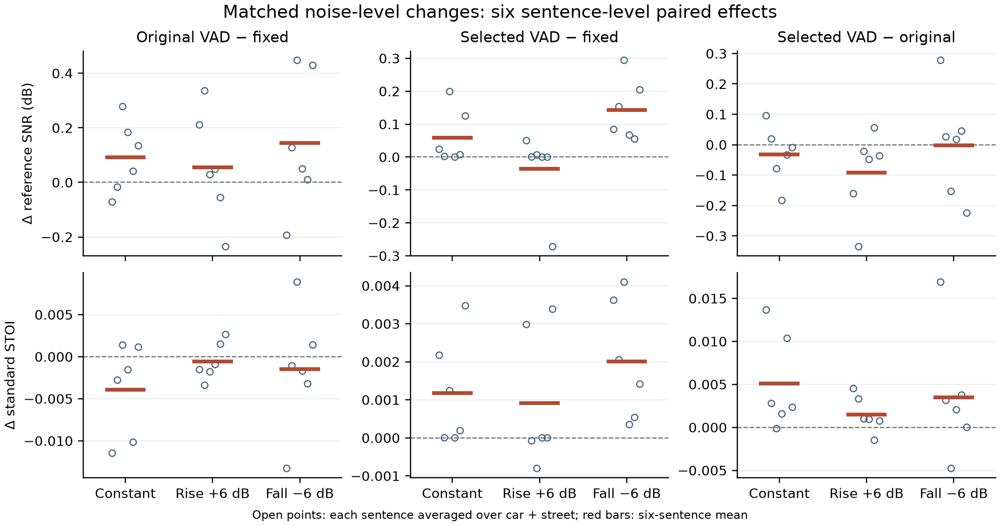
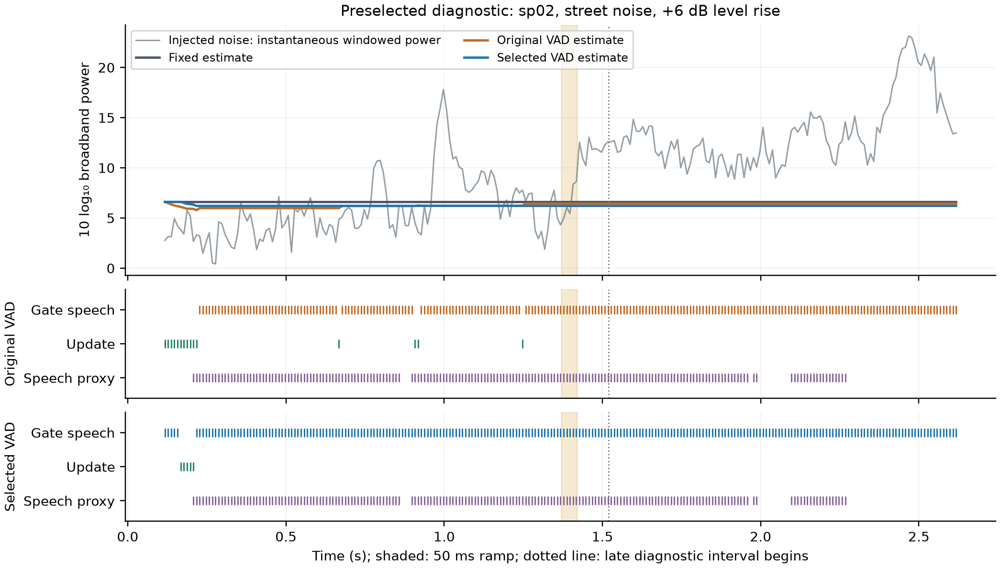
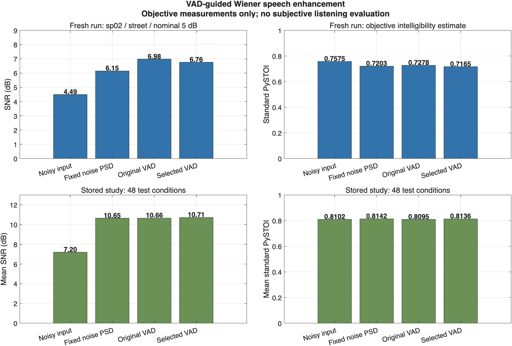

# When does VAD-guided noise updating help Wiener speech enhancement?

**Yulong Chen · SID 550889472 · ELEC5305 · 25 October 2026**

[Final report (PDF)](ELEC5305_Final_Project_Yulong_Chen.pdf) · [Final video](Final_Project/video/index.html) · [GitHub repository](https://github.com/yche0441/elec5305-project-550889472) · [Code and running instructions](Final_Project/README.txt)

The project asks whether voice-activity detection can update a Wiener enhancer's noise estimate without suppressing useful speech. Fixed estimation, original VAD and a more cautious VAD setting share the same TSNR enhancement and reconstruction. The experiment changes the noise-update rule.

## What the completed experiments show

### 1. Frozen parameter comparison

Nine threshold/hangover combinations were compared on 16 development conditions. Threshold **1 dB** and hangover **10 frames** were selected, then frozen before testing six previously unused sentences under eight noise/SNR conditions each. This is a new-sentence test, not a new-speaker test.

| 48-condition method | Mean reference SNR (dB) | Mean standard STOI |
| --- | ---: | ---: |
| Unprocessed | 7.197 | 0.81023 |
| Fixed noise estimate | 10.651 | 0.81422 |
| Original VAD (3 dB, 5 frames) | 10.656 | 0.80953 |
| Selected VAD (1 dB, 10 frames) | 10.715 | 0.81357 |

Selected VAD improves mean STOI over original VAD by **0.00404**. Fixed estimation retains slightly higher mean STOI. The changes are small and do not establish universal superiority. The six sentence units and leave-one-sentence-out checks are reported explicitly; the 48 conditions are not treated as 48 independent speakers.

### 2. Matched noise-level diagnostic

The added experiment holds the speech and base noise fixed and compares constant noise level with a 6 dB rise or fall. It creates **36 mixtures × 4 methods**, with frozen settings and known injected noise. The six sentences were already used, so this is a mechanism diagnostic rather than a new independent generalisation test.

After the rise, neither energy-VAD setting updates in the late interval. The energy increase can keep the speech gate closed to noise updates. After the fall, updates resume; selected VAD has small mean advantages over fixed estimation: **+0.143 dB SNR** and **+0.00201 STOI**. This asymmetry helps explain why “adaptive” does not necessarily mean better tracking.

These measurements support a qualified conclusion: cautious updating limits speech contamination, but may miss opportunities to follow changing noise. STOI is an intelligibility predictor, not a percentage of words understood or a subjective quality rating.

## Watch the final demonstration

The **5 min 24 sec** video explains the research question, method, parameter selection and results, and includes an actual MATLAB run. English captions are included in the picture. The single example is freshly computed; the full-study means and matched noise-change results are clearly identified as stored results.

<video controls playsinline preload="metadata" style="width:100%;max-width:960px;aspect-ratio:16/9;background:#102031" aria-label="ELEC5305 final project demonstration"><source src="Final_Project/video/ELEC5305_Final_Project_Video.mp4" type="video/mp4">Your browser does not support the video player. Use the MP4 download link below.</video>

[Open the video page](Final_Project/video/index.html) · [Download MP4](Final_Project/video/ELEC5305_Final_Project_Video.mp4) · [English SRT captions](Final_Project/video/ELEC5305_Final_Project_English.srt) · [Spoken transcript](Final_Project/video/Final_Video_Transcript.txt)

## See the code in action

Open [START_HERE.m](Final_Project/START_HERE.m) in MATLAB and press Run after installing the documented dependencies. It recomputes **sp02 / street / nominal 5 dB** and verifies the scores against the stored study. The upper panels are a fresh single-case run; the lower panels are stored means from all 48 conditions.

This example is intentionally retained even though selected VAD is not best: processing raises SNR but lowers STOI relative to the input. The following audio is illustrative only; all four clips share the same playback gain and no listener scores are claimed.

**Noisy input**

<audio controls preload="none" src="Final_Project/Final_Project_Video_Prep/demo_generated/01_noisy_input.wav"></audio>

**Fixed noise estimate**

<audio controls preload="none" src="Final_Project/Final_Project_Video_Prep/demo_generated/02_fixed_noise_psd.wav"></audio>

**Original VAD**

<audio controls preload="none" src="Final_Project/Final_Project_Video_Prep/demo_generated/03_original_vad.wav"></audio>

**Selected VAD**

<audio controls preload="none" src="Final_Project/Final_Project_Video_Prep/demo_generated/04_selected_vad.wav"></audio>

The four clips use the same gain so the relative levels are preserved. They are audio examples for inspection, not a completed subjective listening study.

## Reproduce and review

- [Final report](ELEC5305_Final_Project_Yulong_Chen.pdf).
- [Code, dependency setup and complete reproduction instructions](Final_Project/README.txt).
- [Frozen parameter study and protocol](Final_Project/Final_Project_Study/README.txt).
- [Unified metric replay and sentence-level analysis](Final_Project/reanalysis/README_REANALYSIS.txt).
- [Controlled experiment: protocol, complete results and checks](Final_Project/controlled_study/README.txt).
- [Original Feedback Two report](ELEC5305_Project_Feedback_Two_Yulong_Chen_550889472.pdf) and [unchanged original project](Project_Feedback_Two_NOIZEUS/README.md).

All final-report comparisons use standard PySTOI 0.4.1. Original native MATLAB STOI results remain archived separately. The common TSNR code is credited to **LIU Ming / Pascal Scalart**, with its original licence preserved. Speech/noise inputs come from **NOIZEUS / Hu and Loizou**. The contribution is the controlled adaptation, verification, comparative experiments and interpretation; the inherited enhancer is not claimed as a new invention.
