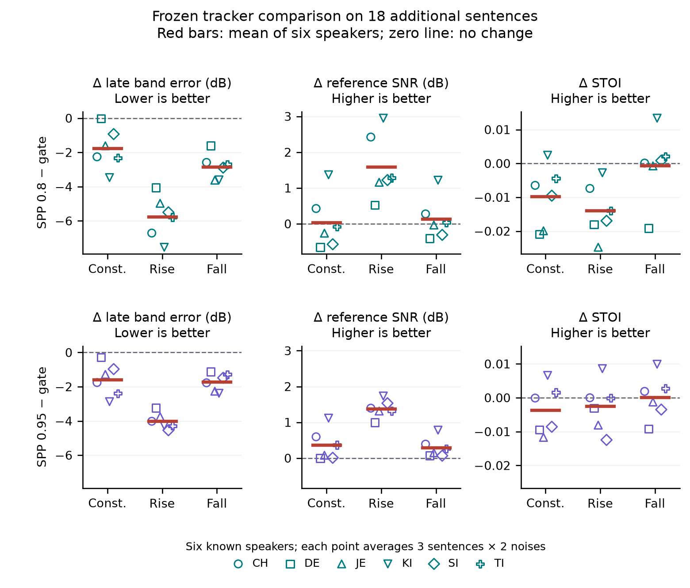
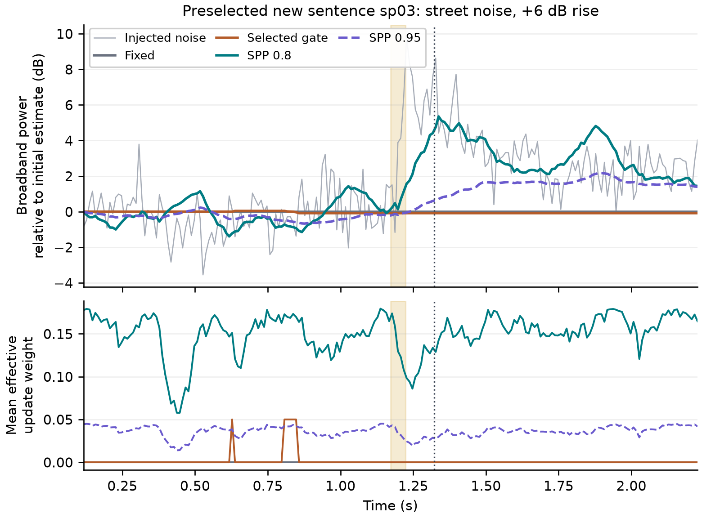
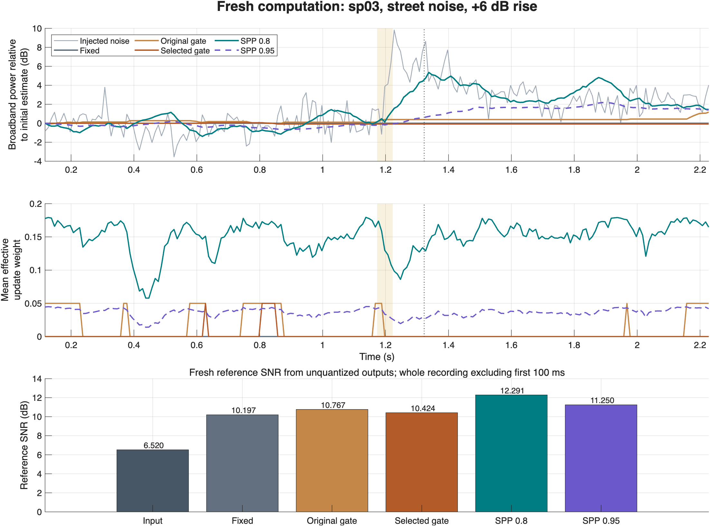

# Noise tracking and speech protection in Wiener enhancement

**Yulong Chen · SID 550889472 · ELEC5305 · 5 November 2026**

[Final report](ELEC5305_Final_Project_Yulong_Chen.pdf) · [Supporting results](Final_Project/report/Supporting_Results.pdf) · [Recorded demonstration](Final_Project/video/index.html) · [GitHub repository](https://github.com/yche0441/elec5305-project-550889472) · [Code and instructions](Final_Project/README.txt)

Can a noise-update rule follow a rising background without suppressing useful speech? This project holds the TSNR Wiener enhancer fixed while comparing fixed estimation, two hard energy gates and a published soft speech-presence probability (SPP) tracker. It tests a response to the observed hard-gate failure, then checks both the recovery and its cost.

## From blocked updates to a tested alternative

The earlier matched experiment showed that a broadband energy increase could keep the hard gate closed to noise updates. The follow-up uses a frequency-wise probability instead of an all-or-nothing frame decision. The published PSD-smoothing coefficient is **0.8**; a predeclared **0.95** version matches the hard gate's smoother. Both settings are frozen before testing, with identical inputs, initial PSDs, TSNR gain processing and reconstruction. This is an adaptation of Gerkmann and Hendriks' estimator on the common 10 ms frame grid, not a new estimator.

The confirmation set contains **18 additional sentences**, three from each of the **same six known speakers**. Two noise types and four nominal SNRs yield 144 constant-noise inputs. A matched rise or fall of 6 dB at nominal 10 dB adds 72 inputs. The earlier 36 diagnostic inputs are a separate regression group. In total, **252 inputs and six methods produce 1,512 retained result rows**.

### Recovery improves noise tracking, with an intelligibility cost

| New rise condition, SPP minus selected hard gate | SPP 0.8 | SPP 0.95 |
| --- | ---: | ---: |
| Late four-band noise-power error (dB), lower is better | −5.76163 | −4.01704 |
| Whole-record reference SNR (dB) | +1.59304 | +1.38209 |
| Late reference SNR (dB) | +2.04997 | +1.85994 |
| Standard STOI | −0.0139782 | −0.00252280 |

The rise-condition tracking error and whole-record reference SNR improve in all 18 sentence means and six speaker means for both variants. The default variant's mean STOI falls for all six speakers. Matching the slower smoother retains much of the SNR improvement with a smaller STOI loss. This supports a targeted tracking improvement, not an overall intelligibility or listening-quality improvement.

Each point averages three sentences and two noises for one known speaker; red bars average the six points. Top and bottom rows share the same vertical scale for each metric. These panels use nominal 10 dB source mixtures. The full constant-noise benchmark also covers nominal 0, 5 and 15 dB: over its 144 inputs, default SPP changes SNR by −0.05915 dB and STOI by −0.0077954 against the selected gate. The matched-smoothing version changes them by +0.19929 dB and −0.0038978. The unchanged-noise cases therefore expose a cost that a rise-only demonstration would miss.

This **sp03 / street / +6 dB rise** example was specified before scoring. Powers refer to the same shared initial estimate. The soft tracker uses continuous binwise weights; these should not be interpreted as a hard gate's binary update-coverage fraction. Four-band error compares estimated and actually injected noise power over the same late interval. It is a finite-window diagnostic, not the true expected noise PSD or a perceptual measure.

## Run and hear the new example

Open [START_HERE.m](Final_Project/START_HERE.m) in MATLAB and press Run. It recomputes all six outputs from the source WAV files and checks fresh SNR, late SNR and band-power measurements against the saved results. Any STOI displayed by this quick MATLAB demo is explicitly labelled a **stored standard Python score**. The quick demo requires no generated waveform archive and no Python scoring installation.

The [demo folder](https://github.com/yche0441/elec5305-project-550889472/tree/main/Final_Project/spp_recovery/demo) contains the six input/output WAVs and clean reference, all sharing one gain. They let the reader inspect the outputs; no listener ratings or subjective conclusions are claimed. The complete computation and playback checks are saved in [DEMO_CHECK.json](Final_Project/spp_recovery/demo/DEMO_CHECK.json).

<strong>Play the seven same-gain examples</strong>

All clips use one common playback gain. The clean reference is included for comparison and is never an input to the enhancer.

<strong>Noisy input</strong>
<audio controls preload="none" style="width:100%" aria-label="Noisy input" src="Final_Project/spp_recovery/demo/01_input.wav"></audio>

<strong>Fixed noise estimate</strong>
<audio controls preload="none" style="width:100%" aria-label="Fixed noise estimate" src="Final_Project/spp_recovery/demo/02_fixed.wav"></audio>

<strong>Original hard gate</strong>
<audio controls preload="none" style="width:100%" aria-label="Original hard gate" src="Final_Project/spp_recovery/demo/03_original_gate.wav"></audio>

<strong>Selected hard gate</strong>
<audio controls preload="none" style="width:100%" aria-label="Selected hard gate" src="Final_Project/spp_recovery/demo/04_selected_gate.wav"></audio>

<strong>Soft SPP 0.8</strong>
<audio controls preload="none" style="width:100%" aria-label="Soft SPP 0.8" src="Final_Project/spp_recovery/demo/05_spp_0_8.wav"></audio>

<strong>Soft SPP 0.95</strong>
<audio controls preload="none" style="width:100%" aria-label="Soft SPP 0.95" src="Final_Project/spp_recovery/demo/06_spp_0_95.wav"></audio>

<strong>Clean reference</strong>
<audio controls preload="none" style="width:100%" aria-label="Clean reference" src="Final_Project/spp_recovery/demo/07_clean_reference.wav"></audio>

## How the earlier work leads to this result

The original parameter study compared nine threshold/hangover settings on development data. The selected 1 dB threshold and ten-frame hangover were frozen before the 48-condition new-sentence test. Mean STOI improved by **0.00404** over original VAD, but remained **0.00064 below fixed estimation**. Reduced speech-associated updating therefore did not establish a generally better enhancer.

In the earlier 36-mixture diagnostic, neither gate made late updates in any of the 12 rising-noise pairs. Falling noise permitted renewed tracking. In the larger follow-up set, the selected gate has zero late updates in **32 of 36** rising cases, so the earlier all-case observation is not extended to every new input. The soft-tracker comparison tests the mechanism while retaining every input and outcome, including failures.

[Supporting Results](Final_Project/report/Supporting_Results.pdf) preserves the older benchmark spectrogram, condition breakdown and sentence-sensitivity figure. The main report remains 12 pages. The earlier code and results remain available in the [parameter study](Final_Project/Final_Project_Study/README.txt), [standard-STOI replay](Final_Project/reanalysis/README_REANALYSIS.txt) and [controlled diagnostic](Final_Project/controlled_study/README.txt).

## Watch the completed recorded demonstration

The completed 6 min 31 sec video has eight chapters, English captions and the presenter’s recorded narration. It retains the original six chapters, including the actual MATLAB run of the earlier sp02 / street / nominal 5 dB example, and adds the soft-SPP follow-up and an updated conclusion. The new section presents stored results in narrated figures and summary cards: 18 additional sentences from the same six known speakers, constant and rising/falling noise, and the predeclared SPP 0.8 and 0.95 comparison. The rise-condition tracking and SNR gains are shown alongside the STOI cost. The soft-SPP section presents the experiment’s recorded results; the runnable new example remains available separately through START_HERE.m.

<video controls playsinline preload="metadata" style="width:100%;max-width:960px;aspect-ratio:16/9;background:#102031" aria-label="Recorded ELEC5305 demonstration covering hard-gate and soft-SPP studies"><source src="Final_Project/video/ELEC5305_Final_Project_Video.mp4" type="video/mp4">Your browser does not support the video player. Use the MP4 download link below.</video>

[Video page](Final_Project/video/index.html) · [MP4](Final_Project/video/ELEC5305_Final_Project_Video.mp4) · [English captions](Final_Project/video/ELEC5305_Final_Project_English.srt) · [Spoken transcript](Final_Project/video/Final_Video_Transcript.txt)

## Reproduce and inspect the evidence

- [12-page final report](ELEC5305_Final_Project_Yulong_Chen.pdf) and [supporting results](Final_Project/report/Supporting_Results.pdf).
- [Complete package with all unquantized outputs](https://github.com/yche0441/elec5305-project-550889472/releases/download/final-video-2026-11-05/ELEC5305_Final_Project_Complete.zip).
- [Quick and full running instructions](Final_Project/README.txt), [follow-up README](Final_Project/spp_recovery/README.txt), and [frozen protocol](Final_Project/spp_recovery/PROTOCOL.json).
- [Every case score](Final_Project/spp_recovery/metrics.csv), [sentence contrasts](Final_Project/spp_recovery/sentence_paired_contrasts.csv), and [speaker contrasts](Final_Project/spp_recovery/speaker_paired_contrasts.csv).
- [Independent numerical audit](Final_Project/spp_recovery/checks/README.txt) and [validation summary](Final_Project/VALIDATION_SUMMARY.txt).
- [Original Feedback Two report](ELEC5305_Project_Feedback_Two_Yulong_Chen_550889472.pdf) and [unchanged original project](Project_Feedback_Two_NOIZEUS/README.md).

The repository includes code, source WAVs, saved tables and the preselected trace. The complete release additionally includes approximately 250 MB of generated waveform chunks. The full MATLAB run regenerates them if the ordinary repository is downloaded. Standard PySTOI 0.4.1 is used consistently, without per-method delay or amplitude fitting. All old baseline waveforms are reproduced exactly.

The TSNR implementation is credited to **LIU Ming / Pascal Scalart**, the soft-SPP estimator and safeguard to **Gerkmann and Hendriks**, and corpus audio to **NOIZEUS / Hu and Loizou**. Their licences and source provenance are retained. The contribution is controlled adaptation, verification and interpretation. These short sentences reuse known speakers, and the imposed level changes do not establish unseen-speaker generalisation or a subjective benefit.
